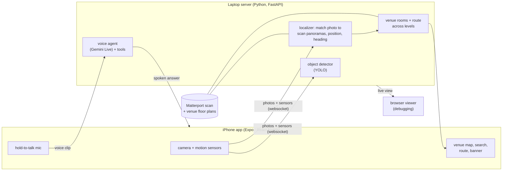

# Insight

Insight helps blind and low-vision people find their way inside a building by voice. Hold up
the phone, ask "take me to the judges room", and it tells you where you are, which way to go,
and warns you about things in your way. It is built on a CoStar/Matterport 3D scan of the
building and, for HackPrinceton, on the venue's floor plans.

## How it works

1. **The phone films and listens.** The app sends a camera photo about once a second, plus
   the phone's motion (tilt, compass, steps). You hold the mic button to talk.
2. **The server works out where you are.** It compares the photo with the 360° photos of
   the Matterport scan to find the nearest scan spot, then measures your exact position
   (to about a metre) and the way you face against the scan's 3D model.
3. **It plans the route.** Rooms come from the HackPrinceton maps: search by number ("A97")
   or by purpose ("judges room", "food", "CoStar"). The route follows the corridors and
   stairs on every level, Level A included.
4. **It guides you.** The app shows the route on the floor plan with the next step in the
   banner ("Turn left, then walk about 8 meters"). The voice assistant answers questions and
   speaks the steps; a very close obstacle (from the object detector) gets a spoken cue
   ("Stop. Chair very close, ahead").

## Architecture



| Part | Where | What it does |
|---|---|---|
| Phone app | `app/` | camera capture, sensors, map screen (`src/VenueMap.js`), room search, voice |
| Server | `server/server.py` | websocket `/ws/phone`, runs detection and localization per frame |
| Localizer | `server/localize.py`, `position.py`, `tracker.py` | place match, metric position, smoothing |
| Venue | `server/venue.py`, `server/venue/` | HackPrinceton rooms, walk graph, routes, spoken steps |
| Voice agent | `server/agent.py` | Gemini Live session with tools (location, directions, rooms) |
| Viewer | `server/viewer/` | browser page at `/` to watch what the server sees |

## Run it on your machine

### 1. Install

You need [uv](https://docs.astral.sh/uv/), Node 20+, ffmpeg, and Xcode with an iPhone for the
app.

```bash
git clone https://github.com/epicgdog/insight.git && cd insight
make setup                  # Python dependencies
make download-models        # object detector weights
cd app && npm install && cd ..
```

Create `.env.local` in the repo root (never commit it):

```bash
GOOGLE_API_KEY=...          # voice agent (Gemini)
MATTERPORT_API_KEY=...      # only to download the scan
MATTERPORT_API_TOKEN=...
```

The scan lives in `data/` (not in git). Get the folder from a teammate, or download it with
`uv run python3 scripts/fetch_matterport.py` (see that script's help). The venue floor
plans are in git (`server/venue/`).

### 2. Start the server

```bash
LOCALIZER=real LOCALIZATION_SCOPE=single uv run python -m server.server
```

It takes 1 to 2 minutes to load, then serves on port 8000. Open http://localhost:8000 for the
viewer. Without the scan data, `make server` starts it with stand-ins (no real localization).

### 3. Let the phone reach it

Same Wi-Fi: the address is `ws://<your laptop's IP>:8000/ws/phone`.
Anywhere, with [Tailscale](https://tailscale.com):

```bash
tailscale funnel --bg 8000                  # server: wss://<machine>.<tailnet>.ts.net/ws/phone
tailscale funnel --bg --https=8443 8081     # app code (Metro), for development builds
```

### 4. Run the app on the iPhone

```bash
cd app
npx expo run:ios --device     # first time: builds and installs the app (5 to 10 min)
EXPO_PACKAGER_PROXY_URL=https://<machine>.<tailnet>.ts.net:8443 npx expo start --dev-client
```

First time only: in Xcode pick your Apple ID team (Signing & Capabilities), on the phone turn on
Settings → Privacy & Security → Developer Mode, and trust your developer profile under
Settings → General → VPN & Device Management.

In the app, open the debug sheet (bug button), enter the server address, press **Start**, and
hold the phone up facing forward. Then search for a room or hold the mic and ask.

For a demo without Metro: `npx expo run:ios --device --configuration Release`.

## Develop

| Command | What it does |
|---|---|
| `uv run pytest` | Python tests |
| `cd app && npm test` | app unit tests |
| `uv run python3 app/dev/echo_server.py` | stand-in server on port 8000 (no models needed) |
| `scripts/tunnel.sh` | Cloudflare tunnel + Expo Go, if you do not use Tailscale |
| `uv run python3 tools/venue_graph.py` | rebuild the venue rooms and corridors (`server/venue/venue.json`) |

Useful settings: `AGENT=0` turns the voice agent off; `AGENT_EVENTS=all` makes it speak every
guidance step on its own (default: only obstacle warnings, otherwise it talks when asked);
`AUTO_NAV=1` starts guidance to the entrance at once.

## Status

Works: localization in the scanned atrium and its corridors (Levels 1 and 2), room search and
routes on all three levels drawn over the walkable floor, the route drawn on the camera image,
voice questions, dropped pins, marking restrooms and fountains.
Not yet: your live position below the scan (Level A shows the route and steps, but the dot
stops at the last scanned spot).
