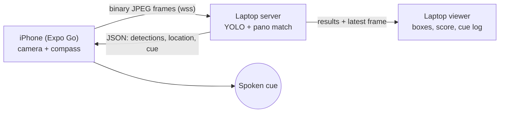

# Insight

Insight lets blind and low-vision people tour a property independently, guided by voice, using CoStar 3D data.

Demo target: Princeton – Rabinowitz Hall, API model `P3S6VUTP3qB` (public viewer `6sd6A5r5EVp`), one scan position.

This repository combines the core server, iPhone app, viewer and Matterport localization.
See INTEGRATION.md, PROPERTY-VERIFICATION.md and NAVIGATION.md for verified results
and the remaining native-phone tracking and metric-navigation integration.

## Architecture



```text
phone -> server -> cues
```

## Quick start

Requires `uv`, Node, Chrome (viewer test and backup video) and `ffmpeg` (backup video).

```bash
# 1. Install dependencies and start the core server
make setup
make download-models
make server                                 # http://localhost:8000, viewer at /
# After fetching references and calibration: LOCALIZER=real make server

# 2. Tunnel + phone app: prints the address and a QR, then starts Expo
scripts/tunnel.sh                              # install Expo Go, scan the Expo QR, tap Allow

# 3. Open the viewer on the laptop
open http://localhost:8000
```

On the phone: install **Expo Go**, scan the QR that Expo prints, then tap **Allow** for camera, location and speech. The server address is already filled in. Tap **Start**, and raise the volume.

**Intel Mac (no PyTorch build):** `make server` fails there. Put `yolo11n.onnx` (YOLO exported to ONNX on any machine with PyTorch: `yolo export model=yolo11n.pt format=onnx imgsz=640 opset=12 simplify=True`) in `data/models/`, then `RECORD=1 make -f make/part3.mk p3-server-lite`. It runs the same server with `DETECTOR=onnx` (YOLO through OpenCV, same boxes as Ultralytics on that file) and the localizer's weight-free fallbacks (SIFT, HOG) instead of LightGlue and DINOv2. `make -f make/part3.mk p3-onnx-check IMAGE=photo.jpg` lists what it detects.

## Commands

| Command | What it does |
| --- | --- |
| `uv run python3 app/dev/echo_server.py` | stand-in server on port `8000` (`INSIGHT_PORT` to change) |
| `scripts/tunnel.sh` | Cloudflare quick tunnel + Expo with the server address baked in |
| `scripts/tunnel.sh --dry-run` | print the address and QR only; do not start Expo |
| `uv run pytest` | Python integration tests (boots the stand-in server, drives node and Chrome) |
| `node --test "app/test/unit/*.test.js" "server/viewer/test/*.test.js"` | JS unit tests |
| `uv run python3 slides/build_deck.py` | build `slides/blindsight.pptx` (8 slides, speaker notes; `--presenting` adds local images from `data/` into the git-ignored `slides/blindsight-presenting.pptx`; see `slides/demo_runbook.md`) |
| `uv run python3 tools/render_backup_video.py --out slides/backup.mp4` | render the backup video (`--seconds`, `--fps`) |
| `make -f make/part2.mk <target>` | `part2-echo`, `part2-tunnel`, `part2-test`, `part2-app-test`, `part2-video`, `part2-slides` |

### Environment variables

| Variable | Used by | Default |
| --- | --- | --- |
| `INSIGHT_PORT` | echo server, tunnel script | `8000` |
| `INSIGHT_TUNNEL_TIMEOUT` | tunnel script: seconds to wait for the tunnel URL | `30` |
| `INSIGHT_EXPO_ARGS` | tunnel script: extra args for `expo start` (e.g. `--tunnel`) | empty |
| `INSIGHT_NO_EXPO` | tunnel script: skip starting Expo | unset |
| `INSIGHT_DATA` | echo server: where captured frames go | `./data` |
| `EXPO_PUBLIC_SERVER_URL` | phone app: pre-filled server address (set by `tunnel.sh`) | empty |
| `CHROME` | video renderer: path to Chrome | macOS default install path |

Secrets live only in `.env.local`, which is git-ignored. No script prints them.

## Wire contracts

### Phone to server: `/ws/phone` (binary)

One WebSocket message per frame:

```text
| 4 bytes: N, big-endian unsigned | N bytes: UTF-8 JSON header | remaining bytes: JPEG |
```

Header keys: `seq`, `ts_ms` (client send time), `heading_deg` (compass degrees or `null`), `w`, `h`.
Optional keys (older phones omit them): `pitch_deg` (camera pitch from the accelerometer, + looks up, within +/-90), `roll_deg` (within +/-180), `moving` (`true` while the user is walking, `false` when still).

### Server to phone and viewer (JSON text)

```json
{
  "seq": 7,
  "server_ms": {"decode": 1.0, "yolo": 2.0, "embed": 1.0, "total": 4.0},
  "detections": [{"cls": "chair", "conf": 0.91, "bbox": [0.3, 0.4, 0.6, 0.9], "direction": "ahead", "distance": "close"}],
  "location": {"pano_id": "...", "label": "Main lobby", "score": 0.82, "ema": 0.8, "best_ref": 2,
               "state": "LOCKED", "inliers": 57, "yaw_deg": 12.0, "yaw_conf": 0.9},
  "cue": {"id": "loc-main-lobby", "text": "You are in the main lobby", "priority": 2, "interrupt": true}
}
```

`bbox` is normalized `[x1, y1, x2, y2]`. `state` is `LOCKED`, `UNCERTAIN` or `LOST`. `cue` is `null` when there is nothing to say. The viewer socket `/ws/viewer` carries the same JSON plus `jpeg_b64`, the latest frame.

### HTTP endpoints

| Endpoint | Purpose |
| --- | --- |
| `GET /` | the viewer |
| `GET /api/pano` | label, six face URLs, thresholds |
| `POST /api/capture/pos`, `POST /api/capture/neg` | save the latest frame as a positive or negative example |
| `POST /api/capture/auto?seconds=20` | start the warm-up; `GET /api/capture/auto` reports progress |
| `GET /metrics` | rolling `p50_ms`, `p95_ms`, `fps` |

The stand-in server implements all of these with canned data. Part 1's server implements the real ones.

## Phone app (`app/`)

Expo Go only, no dev build. Uses `expo-camera`, `expo-speech`, `expo-location` (compass heading), `expo-keep-awake` and `expo-screen-orientation`.

- **Capture loop** (`src/loop.js`): sequential. It awaits a low-quality (0.3), EXIF-free, unprocessed capture, then sends, and never starts a capture before the previous send returns. Capture time is logged, with a warning above 250 ms.
- **Speech** (`src/speech.js`): a cue with `interrupt: true` stops current speech and speaks. Otherwise a cue is spoken only if the phone is idle, and dropped, never queued. Cues are deduplicated by `id`. At startup it says "Insight ready" as a volume check.
- **Reconnect** (`src/client.js`, `src/reconnect.js`): exponential backoff from 0.5 s up to 8 s. It speaks "Connection lost" once on disconnect and "Reconnected" on recovery.
- **Address** (`src/address.js`): accepts `https://`, `http://`, `wss://`, `ws://` or a bare `host:port` and normalizes to a `/ws/phone` WebSocket URL. The value is persisted on the phone.
- **Layout**: portrait lock, keep-awake, server address field, Start/Stop, a status line (connected, state, fps) and a small camera preview.

## Viewer (`server/viewer/`)

Static HTML and vanilla JS, no build step, no CDN, no external requests, so it works with venue Wi-Fi down. Large type and high contrast for reading from 2 m.

Panels: live frame with detection boxes, a big `LOCKED` / `UNCERTAIN` / `LOST` badge with score, inliers, yaw and a score sparkline, a reference-view strip with the best match highlighted, a timestamped cue log, latency and fps, and the capture buttons.

**Warm-up flow:** during the demo the person stands still for 20 seconds while the phone streams. The viewer's warm-up button calls `POST /api/capture/auto?seconds=20` and shows progress and how many frames were kept.

`logic.js` holds the pure helpers (state classes, sparkline points, box styles, cue log, fps) so they can be unit tested without a browser.

## Tunnel (`scripts/tunnel.sh`)

1. Installs `cloudflared` with Homebrew if it is missing.
2. Starts `cloudflared tunnel --url http://localhost:8000` (no account needed) and waits for the `trycloudflare.com` URL.
3. Prints `EXPO_PUBLIC_SERVER_URL=wss://<host>/ws/phone` and a QR code, then starts Expo with that value baked in, so the app opens with the address filled in.
4. If the tunnel fails, falls back to the LAN IP (`ws://<ip>:8000/ws/phone`) and says so.

Metro itself is served over the LAN. If venue Wi-Fi isolates clients, run `INSIGHT_EXPO_ARGS=--tunnel scripts/tunnel.sh`. If iOS refuses `ws://`, use ngrok or Tailscale with `wss://`.

## Backup video

`tools/render_backup_video.py` pans a virtual camera across a synthetic pano, feeds the frames to the server, captures the viewer with headless Chrome over the DevTools protocol, and encodes the result with `ffmpeg`. Every frame carries a **SIMULATED FEED** banner. It uses `tools/synthetic_feed.py` (Part 3) if present, otherwise a built-in placeholder pano. Keep a copy on a second device.

## Testing

Integration tests were written before the implementation.

| Test file | Covers |
| --- | --- |
| `tests/part2/test_wire_format.py` | frame in, JSON out, malformed frames, first cue is the location cue |
| `tests/part2/test_endpoints.py` | viewer assets, pano, metrics, capture, warm-up, viewer socket |
| `tests/part2/test_phone_client_integration.py` | the app's real JS modules against the live stand-in server (round trip under 300 ms, cue spoken once) |
| `tests/part2/test_viewer.py` | no external requests, required panels, live render in headless Chrome |
| `tests/part2/test_tunnel.py` | tunnel to `wss://`, LAN fallback, QR, no secrets printed |
| `tests/part2/test_backup_video.py` | renders a labelled H.264 clip |
| `tests/part2/test_pitch_and_docs.py` | pitch under 3:00, no unmeasured numbers, deck, README, make targets, secrets not tracked |
| `app/test/unit/`, `server/viewer/test/` | protocol, speech, reconnect, address, loop, client, base64, viewer logic |

The phone app is verified to bundle (`npx expo export --platform ios`) but has not been run on a physical iPhone.

## Layout

| Path | What |
| --- | --- |
| `app/` | Expo Go phone app |
| `app/dev/echo_server.py` | stand-in server speaking the wire contracts |
| `server/viewer/` | static laptop viewer |
| `scripts/tunnel.sh` | tunnel, LAN fallback, Expo QR |
| `make/part2.mk` | Part 2 make targets |
| `slides/` | deck, timed pitch script, tough-question prep |
| `tools/render_backup_video.py` | simulated-feed backup video |
| `tests/part2/` | Python integration tests |
| `NOTES-part2.md` | assumptions, open items, measured numbers |

## Localization: IMU, metric position, tracking

Added on top of the multi-place localizer (`server/localize.py`).

**IMU pitch gate.** The phone derives camera pitch and roll from gravity (`app/src/attitude.js`, expo-sensors) and sends them in every frame header. A verified match whose pitch differs from the phone's by more than `P3_PITCH_GATE_DEG` (15) is rejected (`last_debug["imu_rejected"]`). `tools/eval_pitch_gate.py` runs the 40 synthetic test walkthroughs with and without it: identical results on simulated data (40/40 locked on the right place, 0 wrong frames, the gate never fired), so its benefit still has to be shown on site.

**Metric position (depth + PnP).** `server/position.py` ray casts the matched reference keypoints into the scan mesh and solves `cv2.solvePnPRansac`, giving the camera centre instead of only "at scan point X". The pano-to-mesh rotation was not documented; `tools/calibrate_pano_frame.py` tests 24 candidate frames with cross-pano PnP on 25 real pano pairs and writes the winner to `data/matterport/pano_frame.json` (median error 0.14 m, runner-up 2.4 m). Casts are cached per reference keypoint and run on a worker thread, so frames never wait for the mesh. The result is in the viewer payload as `match.position` (mesh x, y, z, offset from the pano, inliers). Procedural-room tests: within about 1 cm up to 2.2 m from the scan point. `P3_POSITION=0` turns it off.

**Still-phone hold.** The phone flags walking from the spread of the accelerometer magnitude over 1.5 s (turning on the spot counts as still) and sends `moving`; the status line shows `walking` / `still`. While still, the reported place cannot switch. Thresholds are not yet tuned on a real phone.

**"Where on the pano" panel.** Shows the pano of the highest-confidence view of each frame (the verified candidate with the most inliers, `match.pano`) and draws the footprint from that view, so picture and outline always agree.

**Kalman tracker.** `server/tracker.py` tracks the user on the floor plan (constant-velocity filter on x, y; height from the last accepted fix). Every verified match is a measurement: the PnP fix (sigma from inliers and offset) or, without one, the matched scan point (sigma 1 m). Process noise follows the walking flag, so standing still averages fixes and walking follows at normal speeds. A match more than the 99% chi-square bound from the track, or on another floor, is rejected; if it is for a different place it does not count as matched, which stops jumps to far-away scan points. Three rejected fixes in a row that agree within 1 m restart the track there (only while walking, so a repeated look-alike seen while standing cannot win). `match.position` now carries the tracked point, its sigma, the source (`pnp`, `scan_point`, `track`) and the raw fix.

Evaluation scripts (simulated data unless noted): `tools/eval_pitch_gate.py`, `tools/eval_position.py`, `tools/calibrate_pano_frame.py` (real pano pairs).

## Status and limits

- Runs against the stand-in server with canned results; real YOLO and pano matching arrive with Parts 1 and 3.
- The demo covers one scan point. Multi-pano routing and Vexcel exterior guidance are roadmap, not built.
- Not yet tested with blind users.
- No measured accuracy or latency numbers are recorded yet; the pitch quotes none.

## Troubleshooting

- **Phone cannot connect:** try the tunnel URL, then the LAN URL, then `INSIGHT_EXPO_ARGS=--tunnel`.
- **No sound:** check the phone is not on silent, raise the volume, and listen for "Insight ready".
- **Capture slower than 250 ms:** lower the capture quality and size in `app/App.js`; if still slow, move to `react-native-vision-camera` with a dev build.
- **Viewer shows nothing:** confirm the phone is streaming; the viewer only updates while frames arrive.
