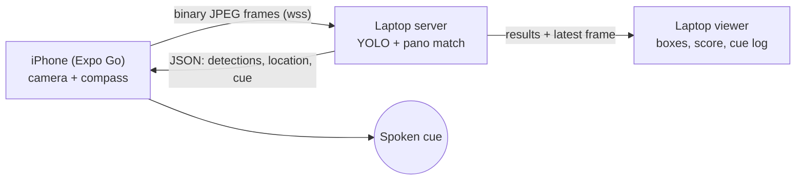

# Blindsight

Blindsight lets blind and low-vision people tour a property independently, guided by voice, using CoStar 3D data.

Demo target: HackPrinceton main lobby, Matterport model `6sd6A5r5EVp`, one scan position.

This branch holds **Part 2**: the iPhone app, the laptop viewer, the tunnel script, the backup video and the pitch assets. The core server (Part 1) and Matterport localization (Part 3) talk to it only through the wire contracts below. Until they land, `app/dev/echo_server.py` stands in for the server.

## Architecture



```text
phone -> server -> cues
```

## Quick start

Requires `uv`, Node, Chrome (viewer test and backup video) and `ffmpeg` (backup video).

```bash
# 1. Server: Part 1's real server when it lands; until then the stand-in
uv run python3 app/dev/echo_server.py          # http://localhost:8000, viewer at /

# 2. Tunnel + phone app: prints the address and a QR, then starts Expo
scripts/tunnel.sh                              # install Expo Go, scan the Expo QR, tap Allow

# 3. Open the viewer on the laptop
open http://localhost:8000
```

On the phone: install **Expo Go**, scan the QR that Expo prints, then tap **Allow** for camera, location and speech. The server address is already filled in. Tap **Start**, and raise the volume.

## Commands

| Command | What it does |
| --- | --- |
| `uv run python3 app/dev/echo_server.py` | stand-in server on port `8000` (`BLINDSIGHT_PORT` to change) |
| `scripts/tunnel.sh` | Cloudflare quick tunnel + Expo with the server address baked in |
| `scripts/tunnel.sh --dry-run` | print the address and QR only; do not start Expo |
| `uv run pytest` | Python integration tests (boots the stand-in server, drives node and Chrome) |
| `node --test "app/test/unit/*.test.js" "server/viewer/test/*.test.js"` | JS unit tests |
| `uv run python3 slides/build_deck.py` | build `slides/blindsight.pptx` |
| `uv run python3 tools/render_backup_video.py --out slides/backup.mp4` | render the backup video (`--seconds`, `--fps`) |
| `make -f make/part2.mk <target>` | `part2-echo`, `part2-tunnel`, `part2-test`, `part2-app-test`, `part2-video`, `part2-slides` |

### Environment variables

| Variable | Used by | Default |
| --- | --- | --- |
| `BLINDSIGHT_PORT` | echo server, tunnel script | `8000` |
| `BLINDSIGHT_TUNNEL_TIMEOUT` | tunnel script: seconds to wait for the tunnel URL | `30` |
| `BLINDSIGHT_EXPO_ARGS` | tunnel script: extra args for `expo start` (e.g. `--tunnel`) | empty |
| `BLINDSIGHT_NO_EXPO` | tunnel script: skip starting Expo | unset |
| `BLINDSIGHT_DATA` | echo server: where captured frames go | `./data` |
| `EXPO_PUBLIC_SERVER_URL` | phone app: pre-filled server address (set by `tunnel.sh`) | empty |
| `CHROME` | video renderer: path to Chrome | macOS default install path |

Secrets live only in `.env.local`, which is git-ignored. No script prints them.

## Wire contracts

### Phone to server: `/ws/phone` (binary)

One WebSocket message per frame:

```text
| 4 bytes: N, big-endian unsigned | N bytes: UTF-8 JSON header | remaining bytes: JPEG |
```

Header keys: `seq`, `ts_ms` (client send time), `heading_deg` (compass degrees or `null`), `w`, `h`.

### Server to phone and viewer (JSON text)

```json
{
  "seq": 7,
  "server_ms": {"decode": 1.0, "yolo": 2.0, "embed": 1.0, "total": 4.0},
  "detections": [{"cls": "chair", "conf": 0.91, "bbox": [0.3, 0.4, 0.6, 0.9], "direction": "ahead", "distance": "close"}],
  "location": {"pano_id": "...", "label": "Main lobby", "score": 0.82, "ema": 0.8, "best_ref": 2,
               "state": "LOCKED", "inliers": 57, "yaw_deg": 12.0, "yaw_conf": 0.9},
  "cue": {"id": "loc-main-lobby", "text": "You are in the main lobby", "priority": 2, "interrupt": true}
}
```

`bbox` is normalized `[x1, y1, x2, y2]`. `state` is `LOCKED`, `UNCERTAIN` or `LOST`. `cue` is `null` when there is nothing to say. The viewer socket `/ws/viewer` carries the same JSON plus `jpeg_b64`, the latest frame.

### HTTP endpoints

| Endpoint | Purpose |
| --- | --- |
| `GET /` | the viewer |
| `GET /api/pano` | label, six face URLs, thresholds |
| `POST /api/capture/pos`, `POST /api/capture/neg` | save the latest frame as a positive or negative example |
| `POST /api/capture/auto?seconds=20` | start the warm-up; `GET /api/capture/auto` reports progress |
| `GET /metrics` | rolling `p50_ms`, `p95_ms`, `fps` |

The stand-in server implements all of these with canned data. Part 1's server implements the real ones.

## Phone app (`app/`)

Expo Go only, no dev build. Uses `expo-camera`, `expo-speech`, `expo-location` (compass heading), `expo-keep-awake` and `expo-screen-orientation`.

- **Capture loop** (`src/loop.js`): sequential. It awaits a low-quality (0.3), EXIF-free, unprocessed capture, then sends, and never starts a capture before the previous send returns. Capture time is logged, with a warning above 250 ms.
- **Speech** (`src/speech.js`): a cue with `interrupt: true` stops current speech and speaks. Otherwise a cue is spoken only if the phone is idle, and dropped, never queued. Cues are deduplicated by `id`. At startup it says "Blindsight ready" as a volume check.
- **Reconnect** (`src/client.js`, `src/reconnect.js`): exponential backoff from 0.5 s up to 8 s. It speaks "Connection lost" once on disconnect and "Reconnected" on recovery.
- **Address** (`src/address.js`): accepts `https://`, `http://`, `wss://`, `ws://` or a bare `host:port` and normalizes to a `/ws/phone` WebSocket URL. The value is persisted on the phone.
- **Layout**: portrait lock, keep-awake, server address field, Start/Stop, a status line (connected, state, fps) and a small camera preview.

## Viewer (`server/viewer/`)

Static HTML and vanilla JS, no build step, no CDN, no external requests, so it works with venue Wi-Fi down. Large type and high contrast for reading from 2 m.

Panels: live frame with detection boxes, a big `LOCKED` / `UNCERTAIN` / `LOST` badge with score, inliers, yaw and a score sparkline, a reference-view strip with the best match highlighted, a timestamped cue log, latency and fps, and the capture buttons.

**Warm-up flow:** during the demo the person stands still for 20 seconds while the phone streams. The viewer's warm-up button calls `POST /api/capture/auto?seconds=20` and shows progress and how many frames were kept.

`logic.js` holds the pure helpers (state classes, sparkline points, box styles, cue log, fps) so they can be unit tested without a browser.

## Tunnel (`scripts/tunnel.sh`)

1. Installs `cloudflared` with Homebrew if it is missing.
2. Starts `cloudflared tunnel --url http://localhost:8000` (no account needed) and waits for the `trycloudflare.com` URL.
3. Prints `EXPO_PUBLIC_SERVER_URL=wss://<host>/ws/phone` and a QR code, then starts Expo with that value baked in, so the app opens with the address filled in.
4. If the tunnel fails, falls back to the LAN IP (`ws://<ip>:8000/ws/phone`) and says so.

Metro itself is served over the LAN. If venue Wi-Fi isolates clients, run `BLINDSIGHT_EXPO_ARGS=--tunnel scripts/tunnel.sh`. If iOS refuses `ws://`, use ngrok or Tailscale with `wss://`.

## Backup video

`tools/render_backup_video.py` pans a virtual camera across a synthetic pano, feeds the frames to the server, captures the viewer with headless Chrome over the DevTools protocol, and encodes the result with `ffmpeg`. Every frame carries a **SIMULATED FEED** banner. It uses `tools/synthetic_feed.py` (Part 3) if present, otherwise a built-in placeholder pano. Keep a copy on a second device.

## Testing

Integration tests were written before the implementation.

| Test file | Covers |
| --- | --- |
| `tests/part2/test_wire_format.py` | frame in, JSON out, malformed frames, first cue is the location cue |
| `tests/part2/test_endpoints.py` | viewer assets, pano, metrics, capture, warm-up, viewer socket |
| `tests/part2/test_phone_client_integration.py` | the app's real JS modules against the live stand-in server (round trip under 300 ms, cue spoken once) |
| `tests/part2/test_viewer.py` | no external requests, required panels, live render in headless Chrome |
| `tests/part2/test_tunnel.py` | tunnel to `wss://`, LAN fallback, QR, no secrets printed |
| `tests/part2/test_backup_video.py` | renders a labelled H.264 clip |
| `tests/part2/test_pitch_and_docs.py` | pitch under 3:00, no unmeasured numbers, deck, README, make targets, secrets not tracked |
| `app/test/unit/`, `server/viewer/test/` | protocol, speech, reconnect, address, loop, client, base64, viewer logic |

The phone app is verified to bundle (`npx expo export --platform ios`) but has not been run on a physical iPhone.

## Layout

| Path | What |
| --- | --- |
| `app/` | Expo Go phone app |
| `app/dev/echo_server.py` | stand-in server speaking the wire contracts |
| `server/viewer/` | static laptop viewer |
| `scripts/tunnel.sh` | tunnel, LAN fallback, Expo QR |
| `make/part2.mk` | Part 2 make targets |
| `slides/` | deck, timed pitch script, tough-question prep |
| `tools/render_backup_video.py` | simulated-feed backup video |
| `tests/part2/` | Python integration tests |
| `NOTES-part2.md` | assumptions, open items, measured numbers |

## Status and limits

- Runs against the stand-in server with canned results; real YOLO and pano matching arrive with Parts 1 and 3.
- The demo covers one scan point. Multi-pano routing and Vexcel exterior guidance are roadmap, not built.
- Not yet tested with blind users.
- No measured accuracy or latency numbers are recorded yet; the pitch quotes none.

## Troubleshooting

- **Phone cannot connect:** try the tunnel URL, then the LAN URL, then `BLINDSIGHT_EXPO_ARGS=--tunnel`.
- **No sound:** check the phone is not on silent, raise the volume, and listen for "Blindsight ready".
- **Capture slower than 250 ms:** lower the capture quality and size in `app/App.js`; if still slow, move to `react-native-vision-camera` with a dev build.
- **Viewer shows nothing:** confirm the phone is streaming; the viewer only updates while frames arrive.
