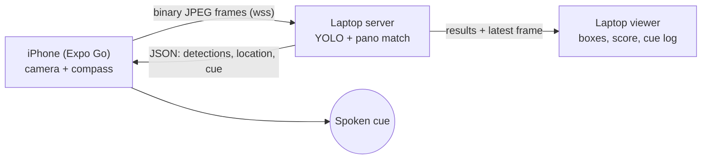

# Blindsight

Blindsight lets blind and low-vision people tour a property independently, guided by voice, using CoStar 3D data.

Demo target: HackPrinceton main lobby, Matterport model `6sd6A5r5EVp`, one scan position.

## Architecture



```text
phone -> server -> cues
```

## Run it

Requires `uv`, Node, and Chrome (for the viewer test and backup video).

```bash
# 1. Server (Part 1's real server when it lands; until then the stand-in)
uv run python3 app/dev/echo_server.py          # http://localhost:8000  (viewer at /)

# 2. Tunnel + phone app: prints the address and a QR, then starts Expo
scripts/tunnel.sh                              # install Expo Go, scan the Expo QR, tap Allow

# 3. Tests
uv run pytest                                  # python integration tests
node --test "app/test/unit/*.test.js" "server/viewer/test/*.test.js"

# 4. Pitch assets
uv run python3 slides/build_deck.py            # slides/blindsight.pptx
uv run python3 tools/render_backup_video.py --out slides/backup.mp4   # ~60 s, labelled SIMULATED
```

`make -f make/part2.mk part2-test` runs the tests; the other targets are in `make/part2.mk`.

## Layout (Part 2)

| Path | What |
| --- | --- |
| `app/` | Expo Go phone app: camera loop, WebSocket client, speech, reconnect |
| `app/dev/echo_server.py` | stand-in server speaking the wire contracts |
| `server/viewer/` | static laptop viewer, no build step, no CDN |
| `scripts/tunnel.sh` | Cloudflare quick tunnel, LAN fallback, Expo QR |
| `slides/` | deck, timed pitch script, tough-question prep |
| `tools/render_backup_video.py` | simulated-feed backup video |

Secrets live only in `.env.local` (git-ignored).
