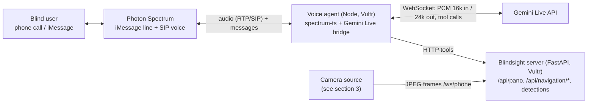

# Blindsight Voice Agent: Plan

Goal: a blind user **phones a number** (or messages it) and talks to Blindsight. No app to open. The agent knows where they are in the property, what the camera sees, and speaks directions.

Stack: **Photon (Spectrum)** for the phone/iMessage channel, **Gemini API** for the brain, **Vultr** for hosting.

> Items marked **VERIFY** came from marketing docs or search snippets. Check them in the first hour before building on them.

## 1. Architecture



Two services on one Vultr box:

| Service | Language | Job |
| --- | --- | --- |
| `voice-agent/` | TypeScript (Spectrum is TS-only) | Receive call audio from Photon, stream to Gemini Live, play Gemini audio back, execute tool calls |
| existing `server/` | Python (FastAPI) | Detections, localization, route and guidance. Unchanged except for new read endpoints |

## 2. Why Gemini Live, not STT then LLM then TTS

Gemini Live API is one bidirectional WebSocket: audio in (16 kHz PCM), audio out (24 kHz PCM), optional image frames, **function calling**, and barge-in (user interrupts the agent). That removes three hops and cuts latency, which matters for a person walking. Fallback if Live misbehaves: Gemini text model plus separate STT/TTS. Do not build the fallback unless needed.

- Pin the model ID from the [official docs](https://ai.google.dev/gemini-api/docs/live-api/get-started-websocket). Search results showed conflicting IDs. **VERIFY**.
- Key from MLH hackathon Gemini access (see earlier notes). Keep in `.env.local`, never in the client.

## 3. The camera problem (decide this first)

Photon voice calls carry **audio only**. The agent has no eyes through the call. Options, cheapest first:

| Option | How | Tradeoff |
| --- | --- | --- |
| A. Matterport only (no live camera) | Agent answers from the 3D model: "you are in the lobby, elevator is 8 m ahead" | Works with zero extra hardware. No real-time obstacle info. Best for demo day |
| B. Photos over iMessage | User (or helper) texts a photo to the same Photon number. Agent sends it to Gemini vision and replies by voice or text | Zero app. Not continuous |
| C. Existing Part 2 phone app streams frames in parallel | App only needs one button, or a helper starts it. Server already does `/ws/phone` | Needs a sighted helper or a one-time setup. Gives continuous detections |
| D. Body-worn camera or glasses | Out of scope for the hackathon | Skip |

Recommendation: **A + B for the demo, C as the stretch**. The voice agent reads the latest detections from the server through a tool, so adding C later changes nothing in the agent.

## 4. Agent tools (Gemini function declarations)

All tools are thin HTTP calls to the Blindsight server. The agent never invents location.

| Tool | Calls | Returns |
| --- | --- | --- |
| `where_am_i()` | `GET /api/pano` (latest location, room name, heading) | room, nearby landmarks, confidence |
| `whats_ahead()` | latest detections from the frame pipeline (new `GET /api/latest`) | objects with clock-position and distance bucket |
| `plan_route(destination)` | `POST /api/navigation/route` | ordered waypoints, distance. Returns 503 if no map, agent must say so |
| `next_instruction()` | `POST /api/navigation/guide` | turn or forward steps, WAYPOINT, ARRIVED |
| `describe_photo(image)` | Gemini vision on an attached image | description for B |

Safety rules baked into the system prompt (they mirror `NAVIGATION.md`):

- Never claim independent safe guidance. Say "I can describe, you stay in control of your cane or guide."
- If a tool says tracking is stale, uncertain or 503, say so plainly and stop giving forward instructions.
- Hazard text interrupts everything. Keep spoken turns short: one instruction, one sentence.
- Do not guess a room that the localizer did not return.

## 5. Photon integration

- SDK: `spectrum-ts` (github.com/photon-hq/spectrum-ts). **VERIFY** current install and auth in the [Photon docs](https://photon.codes/docs/spectrum-ts/introduction).
- Voice: SIP calls on a Spectrum iMessage line. Docs say SDK call control is "coming soon". **VERIFY** whether the SDK exposes raw call audio, or whether we must register as a SIP endpoint and handle RTP ourselves (for example with a SIP/RTP library plus a G.711 or Opus to PCM resampler).
- Audio path if raw RTP: decode to 16 kHz PCM, send to Gemini; take 24 kHz PCM back, resample to the call codec rate (8 kHz G.711 is likely), packetize.
- Security note from third-party coverage: voice RTP is **not SRTP**. Fine for a demo, mention it in the pitch Q&A. **VERIFY**.
- Text and photos use the standard Spectrum message handler. This also gives a free fallback channel if the call path is blocked.

**Kill-switch for the riskiest unknown:** if raw call audio is not reachable in 2 hours, switch to iMessage **voice messages** (Photon adapter lists voice-message support, **VERIFY**). Push-to-talk style: user sends a voice note, agent replies with a voice note. Less magical, still no app.

## 6. Vultr deployment

- One **Cloud Compute** instance, Ubuntu 24.04, 2 vCPU / 4 GB is enough (YOLO inference is the heavy part; if it is slow, size up or keep YOLO on the laptop and expose it through the existing tunnel).
- Open ports: 443 (HTTPS/WSS), UDP range for RTP if Photon needs inbound media (**VERIFY**, may be outbound-only), 22 restricted to your IP.
- Run with Docker Compose (`voice-agent`, `blindsight-server`, `caddy` for TLS). Caddy gets a cert for a domain or a `sslip.io` hostname. This replaces the Cloudflare quick tunnel for the cloud path.
- Secrets: `.env` on the box (`GEMINI_API_KEY`, Photon credentials). Not in git.
- Region: pick the Vultr region nearest the Photon and Google endpoints you test against. Measure round trip before demo.
- Health: `/healthz` already exists on the server. Add one to the voice agent. Use `restart: unless-stopped`.

## 7. Milestones

| # | Milestone | Done when |
| --- | --- | --- |
| 0 | Verify unknowns (Photon call audio, Gemini Live model ID, MLH key) | Each VERIFY line above is resolved or struck |
| 1 | Gemini Live from a laptop mic with one dummy tool | You can talk to it and it calls `where_am_i` |
| 2 | Tools wired to the real server (`/api/pano`, navigation) | Agent answers location from Matterport data, says "can't tell" on 503 |
| 3 | Photon channel: text and photo round trip | Text the number, get a reply; photo gets described |
| 4 | Photon voice call into the Gemini bridge | Phone call from a real phone reaches the agent |
| 5 | Vultr deploy with Compose and TLS | Same demo works with the laptop closed |
| 6 | Safety pass and demo script | Failure phrases tested: tracking lost, 503, no network, interruption |

Milestones 1, 2 and 5 are the guaranteed demo. 3 and 4 are Photon-dependent and the main risk.

## 8. Repo layout (proposed)

```text
voice-agent/
  package.json
  src/
    index.ts          # Spectrum handlers, call lifecycle
    gemini-live.ts    # WebSocket session, audio in/out, tool dispatch
    audio.ts          # codec and resampling
    tools.ts          # HTTP calls to Blindsight server
    prompt.ts         # system prompt and safety rules
  Dockerfile
deploy/
  docker-compose.yml
  Caddyfile
```

Server additions (Python): `GET /api/latest` (last detections plus location in one JSON). Everything else already exists.

## 9. Risks

| Risk | Likelihood | Mitigation |
| --- | --- | --- |
| Photon SDK does not expose call audio | Medium | Voice-note fallback; text channel; laptop-mic demo of the same agent |
| Latency over SIP + Gemini + tools feels slow | Medium | Short replies, tools return small JSON, same-region Vultr, stream audio, no waiting on tools for chit-chat |
| Gemini hallucinates location | Medium | Tools are the only source of location; prompt forbids guessing; return explicit `unknown` |
| Unsafe guidance claims | High impact | Safety prompt, supervised demo, pitch as "orientation and description", not "replaces cane or guide" |
| Gemini rate limits on hackathon key | Low | One session at a time; cache static room descriptions |
| No camera on a call | Certain | Section 3 options |

## 10. Open questions for you

1. Is a **phone call** required for the pitch, or is "message and voice note" acceptable? Decides how hard milestone 4 is.
2. Does the demo include live camera (option C), or Matterport-only (option A)?
3. Does Photon provide a hackathon number or credits? Ask the sponsor table.

## Sources

- [Photon Spectrum intro](https://photon.codes/docs/spectrum-ts/introduction)
- [Photon docs, full text](https://photon.codes/docs/llms-full.txt)
- [Gemini Live API over WebSockets](https://ai.google.dev/gemini-api/docs/live-api/get-started-websocket)
- [Live API reference](https://ai.google.dev/api/live)
